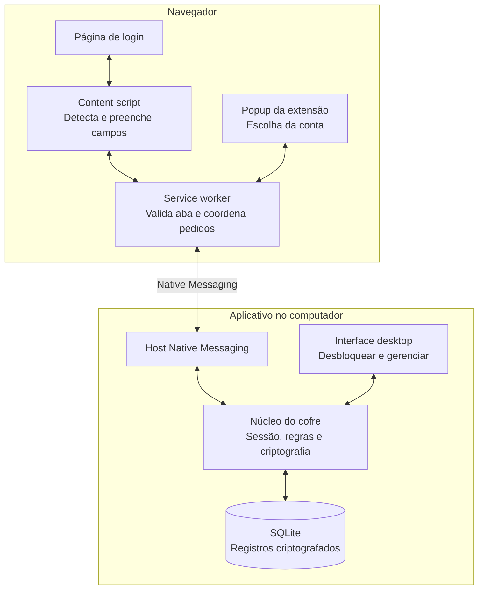
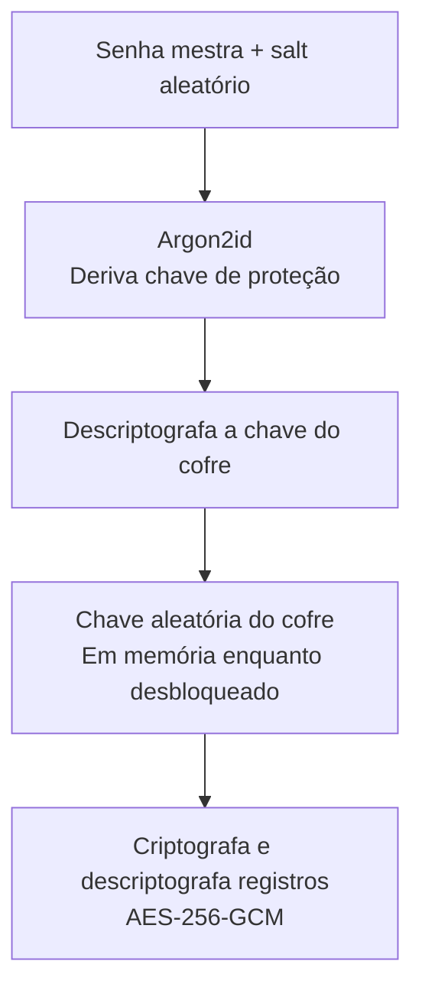

# Gerenciador de senhas local com extensão de navegador

## 1. Objetivo e tecnologias

Criar um cofre de senhas no computador, acompanhado de uma extensão que preenche os campos de login. O cofre funciona sem nuvem; a extensão pede ao aplicativo apenas a credencial necessária para o site aberto.

Proposta inicial: Java para o aplicativo local, JavaFX para a interface desktop, SQLite para persistência e TypeScript para a extensão. A arquitetura descrita é uma proposta de projeto, ainda sem implementação.

## 2. Arquitetura



| Componente | O que faz | Por que existe |
|---|---|---|
| Interface desktop | Cadastra, edita, pesquisa e desbloqueia o cofre | Centraliza o gerenciamento das senhas |
| Núcleo do cofre | Criptografa dados, controla o bloqueio e autoriza consultas | Mantém as regras sensíveis em um único lugar |
| SQLite | Guarda os registros criptografados | Permite armazenamento local e transações |
| Host Native Messaging | Recebe pedidos da extensão | Faz a ponte entre navegador e aplicativo |
| Service worker | Verifica o contexto da aba e coordena o preenchimento | Controla quando uma credencial pode ser liberada |
| Content script | Localiza os campos e insere usuário e senha | Interage com o formulário do site |
| Popup | Mostra contas disponíveis e permite escolher uma | Resolve sites com mais de um login |

Native Messaging é o mecanismo do navegador para conversar com um programa instalado. No Chrome, o content script precisa passar pelo service worker para acessá-lo. O host declara quais extensões podem se conectar, e o instalador do aplicativo registra essa integração. Consulte a [documentação oficial de Native Messaging](https://developer.chrome.com/docs/extensions/develop/concepts/native-messaging).

Se o aplicativo desktop e o host forem processos separados, devem conversar por IPC local com acesso restrito ao usuário do sistema, mantendo uma única sessão do cofre.

## 3. Proteção do cofre

As senhas dos sites precisam ser recuperadas para preencher formulários, então serão criptografadas. Guardar somente um hash impediria recuperar a senha original.



A senha mestra não é salva. O arquivo guarda o salt, os parâmetros do Argon2id e a chave do cofre protegida por criptografia.

Essa separação permite trocar a senha mestra protegendo novamente a chave do cofre, sem recriptografar todas as credenciais. AES-GCM oferece criptografia com verificação de integridade; cada operação deve usar um nonce único para aquela chave, gerenciado com uma biblioteca confiável. Consulte as [orientações de armazenamento criptográfico da OWASP](https://cheatsheetseries.owasp.org/cheatsheets/Cryptographic_Storage_Cheat_Sheet.html).

### Regras de segurança

- Criptografar também títulos, usuários, sites e notas.
- Bloquear após inatividade, suspensão ou bloqueio do computador.
- Invalidar pedidos pendentes quando o cofre bloquear.
- Não persistir senhas ou chaves na extensão nem nos logs.
- Fazer backup criptografado com versão do formato e teste de restauração.

Na primeira versão, sem senha mestra e sem uma forma de recuperação previamente configurada, o backup não poderá ser desbloqueado.

## 4. Fluxo de preenchimento

Exemplo: o usuário abre `https://conta.exemplo.com/login`.

1. A extensão detecta um formulário de login.
2. O service worker obtém o endereço da aba usando as informações do navegador.
3. O aplicativo verifica se o cofre está desbloqueado e busca credenciais autorizadas para essa origem.
4. A extensão recebe inicialmente apenas nomes das contas e identificadores.
5. O usuário escolhe a conta, ou uma regra de preenchimento automático previamente autorizada faz isso.
6. O aplicativo libera aquela credencial.
7. A extensão verifica novamente a aba, o documento e o formulário antes de preencher.
8. Os campos recebem o usuário e a senha; o envio do formulário fica a cargo do usuário.

O content script deve ser tratado como uma parte menos confiável. Suas mensagens precisam ser validadas e seu acesso a informações sensíveis deve ser limitado, conforme a [documentação de troca de mensagens do Chrome](https://developer.chrome.com/docs/extensions/develop/concepts/messaging).

### Modos de preenchimento

| Modo | Comportamento |
|---|---|
| Preencher ao clicar — padrão inicial | O usuário escolhe a conta na extensão e ela preenche |
| Preencher automaticamente — por site | Com o cofre desbloqueado, preenche a conta autorizada ao detectar o login |

O automático exige permissão persistente para atuar naquele site. A proposta inicial usa permissões concedidas por site, permitindo habilitar essa função individualmente.

### Regras de correspondência e formulário

- Autorizar uma origem como `https://conta.exemplo.com`.
- Não considerar `exemplo.com.site-falso.com` uma correspondência.
- Não compartilhar automaticamente uma senha com todos os subdomínios.
- Bloquear preenchimento em HTTP e em frames de outra origem na primeira versão.
- Não preencher campos ocultos nem formulários de troca de senha como se fossem login.

Depois de inserida no formulário, a senha pode ser lida pelo código do próprio site. Por isso, validar o destino antes do preenchimento é essencial.

## 5. Modelo de dados

| Estrutura | Conteúdo |
|---|---|
| `vault_header` | Versão, salt, parâmetros Argon2id e chave do cofre criptografada |
| `vault_item` | ID, versão do registro, nonce e conteúdo criptografado |

Dentro do conteúdo criptografado de cada item:

```json
{
  "title": "Minha conta",
  "username": "alessandro@exemplo.com",
  "password": "...",
  "allowedOrigins": ["https://conta.exemplo.com"],
  "autofillEnabled": false,
  "notes": ""
}
```

Para um cofre pessoal pequeno, os registros podem ser pesquisados em memória enquanto estiver desbloqueado. Isso evita manter um índice de sites em texto aberto.

## 6. Organização do código

O aplicativo será modular, com estas responsabilidades:

| Módulo | Responsabilidade |
|---|---|
| `vault-domain` | Credenciais e regras de correspondência |
| `vault-crypto` | Derivação de chave e criptografia |
| `vault-storage` | Persistência SQLite |
| `vault-application` | Criar, desbloquear, bloquear, buscar e atualizar |
| `vault-desktop` | Interface JavaFX |
| `vault-native-host` | Protocolo com a extensão |
| `browser-extension` | Popup, service worker e preenchimento |

### Protocolo inicial

| Comando | Finalidade |
|---|---|
| `GET_STATUS` | Consultar o estado do cofre |
| `UNLOCK_VAULT` | Desbloquear com senha mestra somente a sessão do aplicativo desktop aberto |
| `LIST_MATCHES` | Listar contas correspondentes à origem autorizada |
| `REQUEST_FILL` | Solicitar a credencial selecionada para um preenchimento autorizado |

O desbloqueio acontece na interface desktop ou no popup da extensão, sempre usando a sessão do aplicativo desktop aberto. A extensão não persiste a senha mestra. Cada pedido de preenchimento fica vinculado à origem, à credencial escolhida e a uma autorização curta. Não existe um comando para entregar o cofre inteiro à extensão.

## 7. Ordem de implementação

1. Criar o cofre local com criptografia, cadastro e bloqueio.
2. Implementar backup e restauração.
3. Conectar uma extensão ao host e consultar o estado do cofre.
4. Mostrar contas correspondentes ao site aberto.
5. Preencher mediante clique.
6. Adicionar preenchimento automático autorizado por site.

O primeiro passo concreto é implementar o núcleo do cofre em Java, porque a interface e a extensão dependem das regras de armazenamento, desbloqueio e autorização.

## 8. Testes essenciais

- Senha mestra incorreta: não deve desbloquear o cofre.
- Dados adulterados: a verificação de integridade deve rejeitá-los.
- Domínio falso: não deve receber credenciais de outro site.
- Navegação durante um pedido: deve invalidar o preenchimento pendente.
- Bloqueio durante o preenchimento: deve invalidar pedidos ainda não concluídos.
- Restauração do backup: deve recuperar o cofre e suas credenciais com a senha correta.

## 9. Referências

- [Chrome — Native Messaging](https://developer.chrome.com/docs/extensions/develop/concepts/native-messaging)
- [Chrome — Message Passing](https://developer.chrome.com/docs/extensions/develop/concepts/messaging)
- [OWASP — Cryptographic Storage Cheat Sheet](https://cheatsheetseries.owasp.org/cheatsheets/Cryptographic_Storage_Cheat_Sheet.html)

Os diagramas estão em Mermaid e podem ser visualizados em editores Markdown que suportam esse formato.
